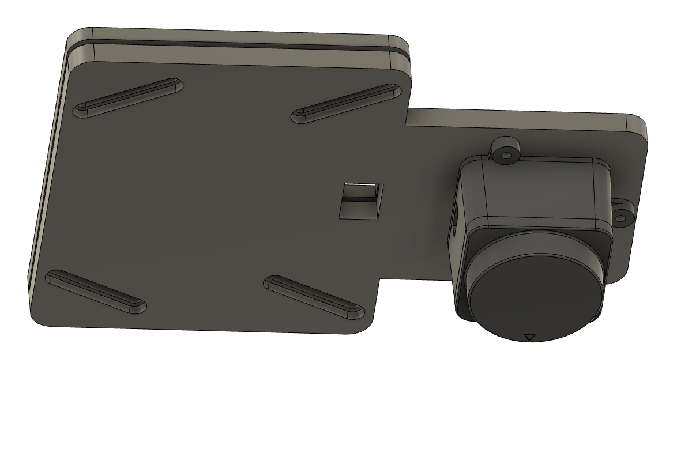

LD19 LiDAR mount, hung upside down under the middle RÅSKOG basket, over the drive axle.

For the LD19 from the Waveshare D500 LiDAR Developer Kit. It goes on the cart's centreline, in the gap between the bottom and middle baskets. The placement is in `ros2_xlerobot_2wheels/docs/rosie-port-plan.md` §2.4.

The drive axle is about 20 mm ahead of the middle basket's front wall, so the LD19 sits on an arm that reaches forward past the wall. The rear part of the lower plate clamps the basket floor.

The two plates clamp the basket's mesh floor:
- The **lower plate** is under the basket. Its arm sticks out past the basket's front wall, and the LD19 hangs from the arm's tip upside down: 3 bosses fit the counterbores under its lugs. 3x M2x10 machine screws go up through the lugs into CNC Kitchen M2 heat-set inserts (M2x3, ⌀3.2 hole, 4 mm deep), pressed in flush from the arm's top face. The LD19's weight pulls each insert against the step at the bottom of its hole, so it can't pull out.
- The **upper plate** is inside the basket. It covers only the clamped part, which stops 15 mm behind the outside of the front wall, where the flat floor begins.
- To place it: slide the plates forward until the LD19's axis is over the axle centre (a plumb line or a square from the axle). The arm's back edge then sits about where the floor starts to curve up into the wall.
- 4x M3x12 bolts go down through both plates and the mesh, into nuts in hex channels under the lower plate.
- The bolt slots run at 26.6° to the mesh grid. Slide each bolt along its slot until it drops through an opening; the channel stops the nut turning wherever it ends up.
- The connector faces the rear. The cable runs back under the arm and up through the cable hole, which is under the flat floor, to the D500 adapter board inside the basket.

**Values for `robot_dimensions.yaml` (`lidar` block):**
- `scan_below_mount`: 0.033. That's the 6 mm lower plate plus the LD19's 27 mm, measured from the basket underside, which is `mount_z`.
- `upside_down`: true.
- `yaw`: 1.5707963. Seen from above, the LD19's forward arrow points to the robot's left. Confirm it in RViz against a wall.
- `x`: 0.0, the LD19 is over the axle. `y`: 0.0 on the centreline. `mount_z`: measure the basket underside above the floor once it's mounted.
- The LD19's head reaches 41 mm below the basket underside. Keep the bottom basket's contents and rim below that, and below the scan plane.

**To measure, then set at the top of `ld19_basket_mount_fusion.py` and rerun:**
- `LD19_AHEAD`: axle centre ahead of the outside of the basket's front wall. 20 mm, measured roughly.
- `FLOOR_INSET`: from the outside of the front wall back to where the flat mesh floor begins (guessed at 15 mm). The clamped part has to stay behind it.
- `MESH_T`: thickness of the basket floor. It sets the gap between the plates and the bolt length, plate + mesh + plate rounded up.
- `MESH_PITCH`: only matters if it's over 10 mm; the slots must span about 2 pitches.
- The mesh openings must be wider than 3.4 mm for an M3 bolt.

Files:
- `ld19_basket_mount_lower.step` / `.stl`, `ld19_basket_mount_upper.step` / `.stl`: the two plates, origin on the LD19's axis at the basket underside.
- `ld19_basket_mount_fusion.py`: a Fusion script that builds both plates into the active design.

Hardware:
- 4x M3x12 socket-head bolts (M3x14 if the mesh is over about 1.5 mm), 4x M3 hex nuts, 4x M3 washers under the heads.
- 3x M2x10 machine screws, 3x CNC Kitchen M2 standard inserts. Set the inserts before mounting anything; the hole is flush with the top face, so press them in from the top.

Printing:
- PET-CF, PETG or PLA. PET-CF needs a hardened nozzle and dry filament.
- Lower plate: bosses up, so its basket face is on the bed. No supports.
- Upper plate: flat, no supports.
- 4 walls, 40% infill, 5 top and 5 bottom layers.
- About 60 g and 30 g.

The earlier head spacer, between the neck and the gimbal head, is no longer used. Put the head back on its M3x12 screws.
